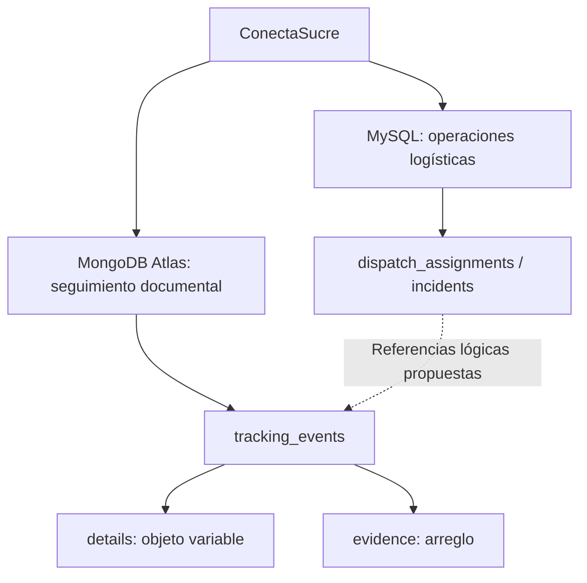

# ConectaSucre — Documentación técnica de la base de datos NoSQL

**Componente:** 10_NOSQL · **Motor:** MongoDB · **Modelo:** documental  
**Entorno:** MongoDB Atlas (clúster gratuito) y MongoDB Compass  
**Estado:** modelo, validación, carga inicial y CRUD ejecutados; consultas analíticas e índices adicionales propuestos.

## 1. Introducción y problemática

ConectaSucre administra la distribución de mercancías mediante pedidos, despachos, vehículos, conductores, rutas y entregas. Durante estas operaciones pueden presentarse fallas mecánicas, bloqueos viales, daños en mercancías y otras novedades que requieren información diferente según su naturaleza. Una falla mecánica necesita registrar el componente afectado y el costo de reparación, mientras que un bloqueo vial requiere conocer su causa y la disponibilidad de un recorrido alternativo.

El modelo relacional implementado en MySQL conserva la información operativa estructurada. Para complementar dicho modelo se implementó una base de datos documental que permite almacenar los detalles particulares de los eventos dentro de una misma colección, sin agregar columnas o tablas especializadas cada vez que se incorpora un nuevo tipo de novedad.

## 2. Objetivo y alcance

Implementar un almacenamiento documental flexible para registrar, consultar, actualizar y eliminar eventos de seguimiento logístico, conservando atributos comunes validados y estructuras internas variables. El alcance académico incluye el despliegue gratuito, el modelo documental, un conjunto sintético de 250 registros y las operaciones CRUD. No se desarrolló una API, una aplicación adicional ni una sincronización automática entre motores.

## 3. Elección tecnológica y arquitectura

MongoDB es una base de datos NoSQL documental que almacena documentos BSON. Permite representar objetos anidados, arreglos, fechas y otros tipos de datos directamente. Se seleccionó por la correspondencia entre su modelo y las novedades heterogéneas del negocio, no por una superioridad de rendimiento demostrada.

| Componente | Configuración | Responsabilidad |
|---|---|---|
| MongoDB Atlas | Clúster `ConectaSucre`, nivel gratuito, 512 MB visibles en la configuración | Alojamiento remoto de la base documental |
| MongoDB Compass | Versión 1.53.3 | Administración, importación y visualización |
| MongoDB Shell | Terminal integrada en Compass | Ejecución de comandos CRUD y consultas |
| MySQL | Esquema `conectasucre_ddl` | Operaciones principales e integridad referencial |



Las líneas discontinuas representan una integración propuesta, no una conexión automática implementada. Las credenciales de Atlas deben mantenerse fuera del repositorio; el acceso se realiza con un usuario de base de datos autorizado y la configuración de red correspondiente.

## 4. Modelo conceptual y físico documental

En MongoDB no se utilizan tablas relacionales para este componente. La unidad de almacenamiento es el documento y su agrupación se denomina colección.

| Elemento | Nombre | Descripción |
|---|---|---|
| Base de datos | `conectasucre_nosql` | Contenedor del componente documental |
| Colección | `tracking_events` | Eventos de seguimiento e incidentes |
| Documento | Un evento | Registro individual de una novedad o hito operativo |
| Identificador | `_id` | ObjectId generado automáticamente |
| Subdocumento | `details` | Atributos propios de cada tipo de evento |
| Arreglo | `evidence` | Referencias a posibles evidencias |

```text
conectasucre_nosql
└── tracking_events
    └── Document
        ├── _id
        ├── dispatch_id
        ├── incident_id
        ├── event_type
        ├── description
        ├── event_date
        ├── delay_minutes
        ├── details
        │   ├── municipality
        │   ├── synthetic
        │   └── Campos particulares del evento
        └── evidence[]
```

Se utiliza una sola colección porque los eventos comparten un contexto, atributos comunes y patrones de consulta. La relación conceptual es un despacho a muchos eventos; aunque el dataset inicial utiliza 250 identificadores de despacho distintos, el modelo permite repetir `dispatch_id`. No se establece una restricción de unicidad sobre este campo.

## 5. Diccionario de datos

| Atributo | Tipo BSON | Obligatorio | Descripción / restricción |
|---|---|---|---|
| `_id` | ObjectId (generado en la carga) | Automático | Identificador único del documento; índice nativo `_id_`. El validador no exige expresamente ObjectId. |
| `dispatch_id` | Int32 | Sí | Identificador lógico del despacho, entero mayor o igual a 1. |
| `incident_id` | Int32 o Null | Sí | Referencia opcional en valor a un incidente; entero positivo si no es nulo. |
| `event_type` | String | Sí | Tipo de evento, texto no vacío. |
| `description` | String | Sí | Descripción textual no vacía del evento. |
| `event_date` | Date | Sí | Fecha y hora BSON, representada en UTC en el dataset. |
| `delay_minutes` | Int32 | Sí | Retraso en minutos, mayor o igual a cero. |
| `details` | Object | Sí | Subdocumento flexible con atributos particulares. |
| `evidence` | Array de objetos | Sí | Referencias a evidencias; puede estar vacío. |

### 5.1. Atributos internos comunes del dataset

| Atributo | Tipo lógico | Descripción |
|---|---|---|
| `details.municipality` | String | Municipio asociado al evento. |
| `details.synthetic` | Boolean | Identifica el carácter sintético del registro. |

Estos dos atributos aparecen en el dataset original, pero el validador actual no los exige individualmente. Los campos internos numéricos se describen como enteros en el JSON; su subtipo BSON no está restringido por el validador.

### 5.2. Atributos particulares por tipo de evento

| Tipo de evento | Campos particulares de `details` | Significado |
|---|---|---|
| `MECHANICAL_FAILURE` | `affected_component` (String), `repair_cost_cop` (entero), `mechanic_required` (Boolean) | Componente afectado, costo en pesos colombianos y necesidad de mecánico. |
| `ROAD_BLOCKAGE` | `blockage_cause` (String), `alternative_route_available` (Boolean) | Causa del bloqueo y disponibilidad de ruta alternativa. |
| `TRAFFIC_DELAY` | `traffic_level` (String), `affected_segment` (String) | Nivel de congestión y tramo afectado. |
| `ACCESS_DIFFICULTY` | `access_condition` (String), `assistance_required` (Boolean) | Condición de acceso y necesidad de asistencia. |
| `ROUTE_CHANGE` | `reason` (String), `extra_distance_km` (entero) | Motivo del cambio y distancia adicional en kilómetros. |
| `DAMAGED_GOODS` | `damage_type` (String), `affected_weight_kg` (entero) | Tipo de daño y peso afectado. |
| `PARTIAL_RETURN` | `returned_weight_kg` (entero), `reason` (String) | Peso devuelto y motivo. |
| `WAREHOUSE_DEPARTURE` | `warehouse` (String), `inspection_completed` (Boolean) | Bodega de salida e inspección completada. |
| `CHECKPOINT` | `checkpoint_name` (String), `inspection_completed` (Boolean) | Punto de control e inspección. |
| `DESTINATION_ARRIVAL` | `arrival_confirmed` (Boolean), `recipient_notified` (Boolean) | Confirmación de llegada y notificación al destinatario. |

## 6. Validación del esquema

La configuración aplicada en Compass utiliza `validationLevel: strict` y `validationAction: error`. De esta manera se rechazan inserciones y actualizaciones que no cumplan el esquema común. La flexibilidad queda en los objetos internos y en los campos adicionales no prohibidos.

```json
{
  "$jsonSchema": {
    "bsonType": "object",
    "required": ["dispatch_id", "incident_id", "event_type", "description", "event_date", "delay_minutes", "details", "evidence"],
    "properties": {
      "dispatch_id": {"bsonType": "int", "minimum": 1},
      "incident_id": {"bsonType": ["int", "null"], "minimum": 1},
      "event_type": {"bsonType": "string", "minLength": 1},
      "description": {"bsonType": "string", "minLength": 1},
      "event_date": {"bsonType": "date"},
      "delay_minutes": {"bsonType": "int", "minimum": 0},
      "details": {"bsonType": "object"},
      "evidence": {"bsonType": "array", "items": {"bsonType": "object"}}
    }
  }
}
```

La aplicación de las reglas quedó confirmada por el mensaje de Compass `New validation rules applied`. El esquema no limita `event_type` a un catálogo cerrado, no exige campos específicos por categoría y no comprueba referencias contra MySQL. Una descripción de espacios en blanco también podría superar `minLength`; si fuera necesario, se ampliaría la validación.

## 7. Dataset sintético

El archivo `02_TRACKING_EVENTS.json` contiene 250 documentos en JSON extendido de MongoDB, con fechas `$date` y enteros `$numberInt` para conservar tipos BSON. Los datos representan escenarios ficticios, no incidentes reales comprobados.

| Tipo de evento | Cantidad |
|---|---:|
| `MECHANICAL_FAILURE` | 40 |
| `ROAD_BLOCKAGE` | 35 |
| `TRAFFIC_DELAY` | 35 |
| `ACCESS_DIFFICULTY` | 25 |
| `ROUTE_CHANGE` | 20 |
| `DAMAGED_GOODS` | 25 |
| `PARTIAL_RETURN` | 20 |
| `WAREHOUSE_DEPARTURE` | 25 |
| `CHECKPOINT` | 15 |
| `DESTINATION_ARRIVAL` | 10 |
| **Total** | **250** |

El dataset contiene 200 novedades y 50 eventos operativos. Los municipios representados son Corozal, Majagual, Sampués, San Marcos, Sincelejo y Toluviejo. Las fechas abarcan del 1 al 24 de noviembre de 2026 (UTC) y los retrasos van de 0 a 360 minutos. Los 250 valores de `incident_id` son nulos y todos los arreglos `evidence` están vacíos. Los identificadores de despacho son sintéticos y no se verificaron contra MySQL.

### 7.1. Ejemplos reales del archivo sintético

**MECHANICAL_FAILURE**

```json
{
  "dispatch_id": {
    "$numberInt": "1"
  },
  "incident_id": null,
  "event_type": "MECHANICAL_FAILURE",
  "description": "Falla mecánica en Sampués",
  "event_date": {
    "$date": "2026-11-13T12:24:00Z"
  },
  "delay_minutes": {
    "$numberInt": "120"
  },
  "details": {
    "affected_component": "Radiator",
    "repair_cost_cop": 60000,
    "mechanic_required": true,
    "municipality": "Sampués",
    "synthetic": true
  },
  "evidence": []
}
```

**ROAD_BLOCKAGE**

```json
{
  "dispatch_id": {
    "$numberInt": "41"
  },
  "incident_id": null,
  "event_type": "ROAD_BLOCKAGE",
  "description": "Bloqueo vial en Sincelejo",
  "event_date": {
    "$date": "2026-11-11T11:20:00Z"
  },
  "delay_minutes": {
    "$numberInt": "285"
  },
  "details": {
    "blockage_cause": "Roadworks",
    "alternative_route_available": true,
    "municipality": "Sincelejo",
    "synthetic": true
  },
  "evidence": []
}
```

**DESTINATION_ARRIVAL**

```json
{
  "dispatch_id": {
    "$numberInt": "241"
  },
  "incident_id": null,
  "event_type": "DESTINATION_ARRIVAL",
  "description": "Llegada al destino en Sampués",
  "event_date": {
    "$date": "2026-11-23T01:26:00Z"
  },
  "delay_minutes": {
    "$numberInt": "0"
  },
  "details": {
    "arrival_confirmed": true,
    "recipient_notified": true,
    "municipality": "Sampués",
    "synthetic": true
  },
  "evidence": []
}
```

## 8. Implementación y carga de datos

1. Crear el clúster gratuito en Atlas y configurar el usuario y acceso de red.
2. Conectar Compass al clúster mediante su URI, sin publicar la contraseña.
3. Crear `conectasucre_nosql` y la colección convencional `tracking_events`.
4. En la pestaña Validation, aplicar el esquema anterior con Strict y Error.
5. En Documents, seleccionar Add Data → Import JSON or CSV file e importar `02_TRACKING_EVENTS.json`.
6. Verificar el total en MongoDB Shell:

```javascript
use conectasucre_nosql
db.tracking_events.countDocuments({})
```

La captura de Compass confirma `Import completed. 250 documents imported.` y muestra documentos con fechas ISODate, objetos y arreglos.

## 9. Operaciones CRUD

Las cuatro operaciones se ejecutaron en la misma sesión de MongoDB Shell, según la confirmación del equipo. Se utilizó un documento temporal identificado por su `_id`, para no alterar los registros originales.

### 9.1. CREATE

```javascript
var testEvent = db.tracking_events.insertOne({
    dispatch_id: NumberInt(25),
    incident_id: null,
    event_type: "MECHANICAL_FAILURE",
    description: "Falla mecánica de prueba",
    event_date: new Date(),
    delay_minutes: NumberInt(60),
    details: {
        affected_component: "Radiator",
        repair_cost_cop: 150000,
        mechanic_required: true,
        municipality: "Sincelejo",
        synthetic: true
    },
    evidence: []
});
printjson(testEvent);
```

Registra una novedad temporal y recupera su identificador. Resultado esperado: `acknowledged: true`, `insertedId` y 251 documentos.

### 9.2. READ

```javascript
db.tracking_events.findOne({_id: testEvent.insertedId});
```

Consulta el documento específico, incluidos los atributos anidados.

### 9.3. UPDATE

```javascript
db.tracking_events.updateOne(
    {_id: testEvent.insertedId},
    {$set: {delay_minutes: NumberInt(90), "details.repair_cost_cop": 200000}}
);
db.tracking_events.findOne({_id: testEvent.insertedId});
```

Actualiza el retraso de 60 a 90 minutos y el costo de reparación de 150.000 a 200.000 COP. La notación de punto modifica un atributo interno sin sustituir todo el subdocumento. Resultado esperado: un documento encontrado y modificado.

### 9.4. DELETE

```javascript
db.tracking_events.deleteOne({_id: testEvent.insertedId});
db.tracking_events.countDocuments({});
```

Elimina exclusivamente el documento de prueba. Resultado esperado: `deletedCount: 1` y retorno a 250 documentos. No se dispone aquí de la captura del resultado final del CRUD; su ejecución fue confirmada por el equipo.

## 10. Consultas, índices y validaciones complementarias

Los siguientes ejemplos quedan propuestos para completar los requisitos de consultas y rendimiento de la rúbrica. No se presentan como pruebas ya ejecutadas.

```javascript
// Consultar fallas mecánicas con retraso de al menos una hora.
db.tracking_events.find({event_type: "MECHANICAL_FAILURE", delay_minutes: {$gte: 60}});

// Consultar documentos por atributo anidado.
db.tracking_events.find({"details.municipality": "Sincelejo"});

// Agrupar eventos y calcular retrasos promedio por categoría.
db.tracking_events.aggregate([
    {$group: {_id: "$event_type", total: {$sum: 1}, average_delay: {$avg: "$delay_minutes"}}},
    {$sort: {total: -1}}
]);

// Consultar la bitácora cronológica de un despacho.
db.tracking_events.find({dispatch_id: NumberInt(25)}).sort({event_date: -1});
```

### 10.1. Indexación

El índice `_id_` único es el índice observado en Compass. Se proponen dos índices adicionales para los patrones frecuentes de consulta:

```javascript
db.tracking_events.createIndex({dispatch_id: 1, event_date: -1}, {name: "idx_dispatch_event_date"});
db.tracking_events.createIndex({event_type: 1, delay_minutes: -1}, {name: "idx_event_type_delay"});
```

El primero facilita recuperar la cronología de un despacho; el segundo favorece filtros por tipo y retraso. Los índices consumen almacenamiento y añaden costo a las escrituras, por lo que deben justificarse según el patrón de acceso. Para comparar los planes antes y después de crear los índices:

```javascript
db.tracking_events.find({dispatch_id: NumberInt(25)}).sort({event_date: -1}).explain("executionStats");
```

Se deben registrar `executionTimeMillis`, `totalDocsExamined`, `totalKeysExamined` y el plan elegido (por ejemplo, COLLSCAN o IXSCAN). No se han medido tiempos reales ni se asegura que el optimizador prefiera un índice en una colección pequeña.

## 11. Integración con el modelo relacional

MySQL conserva el control de pedidos y despachos, así como los incidentes estructurados necesarios para calcular indicadores y penalizaciones. MongoDB complementa esa información mediante los detalles variables del seguimiento.

| Referencia documental | Tabla y atributo relacional | Relación propuesta |
|---|---|---|
| `dispatch_id` | `dispatch_assignments.dispatch_id` | Un despacho puede tener varios eventos. |
| `incident_id` | `incidents.incident_id` | Un evento puede vincularse a un incidente existente. |

El DDL relacional también permite que un incidente se vincule a una entrega o ruta en lugar de un despacho. Para integrar ambos modelos habría que resolver esa asociación antes de registrar el evento documental. MongoDB no aplica claves foráneas entre motores. La carga actual es independiente: no se sincronizó con MySQL ni se comprobó que los identificadores correspondan a las mismas operaciones.

Como estrategia futura se propone validar las referencias en el servicio que registra el evento, conservar MySQL como fuente de verdad de los datos operativos y actualizar MongoDB mediante eventos identificados de forma idempotente, con reintentos y conciliación de inconsistencias. No es necesario desplegar ese servicio para describir la propuesta académica, pero no debe afirmarse que la integración ya funciona.

## 12. Seguridad, particionado y replicación

El acceso al clúster se configuró mediante autenticación de usuario y conexión autorizada. Se recomienda aplicar privilegios mínimos, limitar el acceso de red y conservar credenciales fuera del código. El nivel gratuito se utiliza por su capacidad suficiente para el dataset pequeño.

No se configuró particionado ni una política de replicación propia. Para el volumen actual no se justifica fragmentar la colección. Si el sistema creciera y se adoptara un despliegue compatible con sharding, podría evaluarse `dispatch_id` como clave de particionado, considerando distribución de carga y consultas por despacho. La replicación y recuperación deberían ajustarse a las capacidades del plan contratado y a los requisitos de disponibilidad; no se han comprobado políticas de respaldo o recuperación en este proyecto.

## 13. Estado de implementación y evidencias

| Actividad | Estado |
|---|---|
| Clúster y conexión Compass | Confirmados mediante capturas |
| Base de datos y colección | Confirmadas mediante capturas |
| Validación documental | Aplicación confirmada mediante captura |
| Importación de 250 documentos | Confirmada mediante captura |
| CRUD | Ejecutado según confirmación del equipo |
| Consultas avanzadas y agregaciones | Ejemplos preparados, pendientes de ejecución |
| Índices adicionales y medición | Propuestos, pendientes de ejecución |
| Integración automática y validación cruzada con MySQL | No implementadas |

La documentación se basa en el archivo `02_TRACKING_EVENTS.json`, el DDL relacional `DDL_C.sql`, el esquema aplicado y las capturas y confirmaciones del desarrollo. La base vectorial constituye un componente independiente y no forma parte de esta implementación.

## 14. Justificación final y evaluación de eficiencia

Se seleccionó MongoDB documental porque los eventos logísticos presentan estructuras heterogéneas y se consultan frecuentemente como unidades completas de información. Los objetos anidados permiten agrupar sus detalles sin crear una tabla por cada categoría. MySQL sigue siendo apropiado para transacciones e integridad referencial y también admite JSON; por tanto, la ventaja documental depende del patrón de acceso y no implica que el motor relacional sea incapaz de resolver el problema.

La siguiente tabla evalúa la eficiencia cualitativa de la elección para ConectaSucre. No representa mediciones de latencia, rendimiento ni consumo de recursos.

| Criterio | MongoDB documental | Alternativa relacional u otro modelo NoSQL | Eficiencia y conveniencia para ConectaSucre |
|---|---|---|---|
| Flexibilidad estructural | Objetos variables por evento dentro de una colección. | MySQL puede usar JSON o tablas especializadas; clave-valor suele requerir interpretar el valor. | Alta: reduce cambios estructurales cuando surgen nuevas clases de eventos. |
| Lectura de un evento completo | Detalles y evidencias embebidos en el documento. | Tablas normalizadas podrían requerir JOIN; JSON relacional también permite lectura agrupada. | Favorable para recuperar un evento con sus detalles; velocidad no medida. |
| Actualización | `$set` permite modificar campos anidados puntualmente. | MySQL permite UPDATE y funciones JSON; otros modelos dependen de su API. | Alta conveniencia para cambios específicos sin sustituir el documento completo. |
| Consultas por atributos variables | Filtros por campos anidados y agregaciones. | Clave-valor es menos natural para búsquedas por atributos; grafos favorecen recorridos de relaciones. | Favorable para consultar novedades por causa, municipio o retraso. |
| Validación | JSON Schema controla los atributos comunes. | MySQL ofrece tipos, CHECK y claves foráneas; los controles varían en otros modelos. | Adecuada para datos variables, pero no garantiza referencias entre motores. |
| Integridad y consistencia | Escrituras atómicas por documento; integración externa necesaria. | MySQL ofrece integridad referencial y transacciones relacionales. | MySQL es preferible para operaciones centrales; MongoDB es complementario. |
| Almacenamiento | Evita columnas opcionales vacías, aunque repite nombres de campos y puede duplicar datos. | El modelo normalizado evita ciertas redundancias; JSON relacional también tiene sobrecosto. | Conveniente estructuralmente, sin ahorro de espacio demostrado. |
| Escalabilidad | Admite estrategias de distribución en despliegues compatibles. | Cassandra y otros motores también escalan; grafos responden a otras necesidades. | Potencial favorable, no requerido ni probado con 250 documentos. |
| Costo y complejidad | Atlas gratuito y administración con Compass, sin API adicional. | Motores autogestionados pueden requerir instalación y mantenimiento; otras ofertas gratuitas existen. | Favorable para el alcance universitario y el volumen pequeño. |
| Rendimiento global | Depende de índices, consultas, red y carga. | También depende de configuración y diseño en MySQL y otros motores. | No determinado: requiere mediciones comparables antes de afirmar superioridad. |
